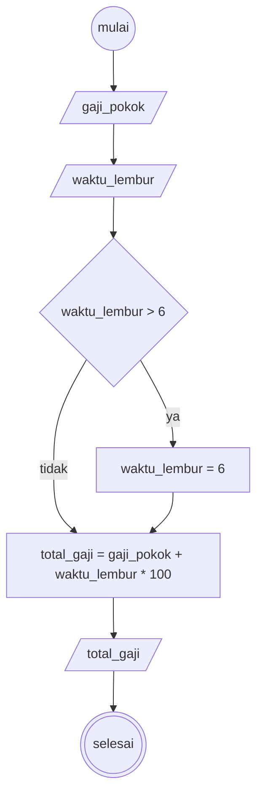

# Algoritma menentukan gaji pegawai

1. mulai
2. tentukan nilai gaji pokok dan waktu lembur (dalam satuan jam)
3. jika waktu lembur lebih dari 6 jam maka hanya akan dihitung 6 jam saja
4. kemudian hitung total gaji yaitu gaji pokok ditambah 100 ribu rupiah per-jam waktu lembur
5. selesai

### Flowchart



### Pseudo Code

```
DECLARE gaji_pokok : INTEGER
DECLARE waktu_lembur : REAL
DECLARE total_gaji : REAL

INPUT gaji_pokok
INPUT waktu_lembur

IF waktu_lembur > 6 THEN
    waktu_lembur  <- 6
ENDIF

total_gaji <- gaji_pokok + waktu_lembur * 100000
OUTPUT total_gaji
```
