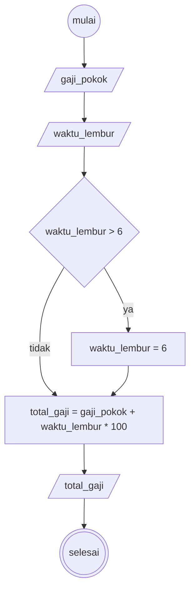

# Algoritma menentukan gaji pegawai

sebuah perusahaan ingin menggaji pegawai nya berdasarkan waktu lemburnya, tetapi waktu lembur yang terhitung hanya 6 jam dalam 1 bulan, jika waktu lembur lebih dari 6 jam maka waktu yang akan diambil hanya 6 jam, jika kurang maka semua waktu lembur itu akan dihitung, untuk setiap jam lembur pegawai akan mendapatkan 100 ribu jadi jika pegawai lembur hingga 3 jam maka ia akan mendapatkan 300 ribu tambahan di gajinya
jika ia lembur hingga 8 jam maka ia hanya akan mendapatkan tambahan 600 ribu saja, terakhir gaji lembur ini kemudian ditambahkan dengan gaji pokok dari pegawai

### Analisis
variabel yang ada berdasarkan cerita diatas:
- Variabel: gaji_pokok, waktu_lembur, dan total_gaji 

### Deskriptif
1. mulai
2. tentukan nilai gaji pokok dan waktu lembur (dalam satuan jam)
3. jika waktu lembur lebih dari 6 jam maka hanya akan dihitung 6 jam saja
4. kemudian hitung total gaji yaitu gaji pokok ditambah 100 ribu per-jam waktu lembur
5. tampilkan total gaji yang sudah dihitung
6. selesai

### Flowchart



### Pseudo Code

```
DECLARE gaji_pokok : INTEGER
DECLARE waktu_lembur : REAL
DECLARE total_gaji : REAL

INPUT gaji_pokok
INPUT waktu_lembur

IF waktu_lembur > 6 THEN
    waktu_lembur  <- 6
ENDIF

total_gaji <- gaji_pokok + waktu_lembur * 100000
OUTPUT total_gaji
```
